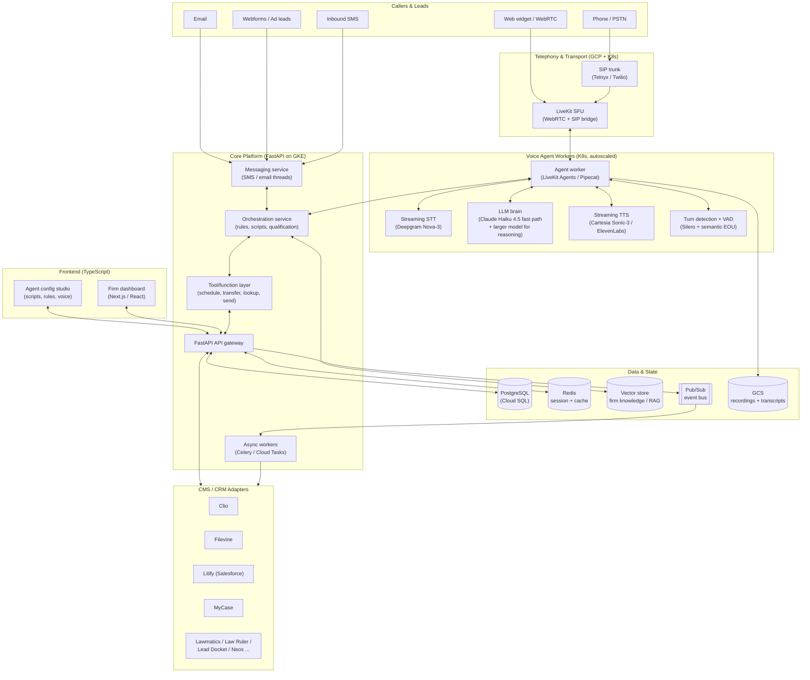

# Caseline: AI Voice Intake Platform for Law Firms

**Project codename: Caseline.** Architecture and production build blueprint for an AI intake employee that answers calls, qualifies leads, books consults, and syncs into a firm's case management system.

Includes a market and stack teardown of a comparable product (Reflekt Legal) as reference, then a full architecture and implementation plan for building Caseline. Written to double as a prototype spec and a reference for a Lead Software Engineer (Voice AI) role.

Last verified: July 2026. Voice tooling moves fast, so re-check component versions and pricing before you commit.

---

## 1. Company Research

### 1.1 What Reflekt Legal is

Reflekt Legal sells "AI employees" to law firms. The firm hires an AI intaker or AI receptionist that works the same channels a human would (phone, email, SMS, webforms, ad listings), qualifies leads, routes calls, schedules consultations, and writes everything back into the firm's existing case management system. The pitch is revenue protection: on their own numbers, around 30 percent of potential clients never convert because of missed calls, and a large share of marketing spend is wasted on leads nobody works properly.

The product is deliberately not another dashboard. The AI does its work inside the CRM or CMS the firm already runs on, so there is nothing new for staff to learn.

### 1.2 Verified facts

- Formerly named **Lead Autopilot** (also "Lead Autopilot AI"). Rebranded to Reflekt Legal in early 2026, publicly announced around SXSW 2026 in Austin.
- Founders: **Abraham Adberstein** (CTO and Co-Founder, and the person reviewing engineering applications), **Jacob Adberstein**, and **Rafael Barroso**.
- **Antler**-backed (featured in Antler's Fall 2025 US portfolio showcase). Seed stage, roughly 600K reported raised at the Lead Autopilot stage.
- Based in **Austin, TX**. The Voice AI engineering role is onsite in Austin.
- Original framing was broader ("AImployees" for sales across SMS, email, voice, WhatsApp). The Reflekt Legal rebrand narrowed the wedge to **legal client intake**.

### 1.3 Product surface (features)

Named features on the site:

- **AI Receptionist** ("legal-receptionist"): answers inbound calls, identifies caller type, routes.
- **Smart Routing**: routes calls based on firm rules and caller classification.
- **Smart Referrals**: hands off cases the firm cannot or will not take.
- **Digital Lead Chaser**: proactively reaches out to inbound digital leads from webforms, email, and ad listings.
- **Treatment Tracker**: personal-injury-specific follow-up that tracks a client's medical treatment progress and document obtainment.

The five-step workflow they advertise:

1. **Handle every contact request.** The AI reaches out to leads across all funnels (phone, webform, email, ad listings).
2. **Real-time qualification and smart call routing.** Identify caller type, qualify, route by firm rules.
3. **Customized handoff.** Live transfer, schedule appointment, send SMS or email, or take a message, depending on outcome.
4. **Centralize in the CRM or CMS.** Log the conversation and structured data into the firm's system after every interaction.
5. **Follow up with signed clients.** Chase missing information, create tasks, track treatment or document obtainment.

### 1.4 Integration landscape (the real moat)

Reflekt integrates directly into legal case management and intake CRMs, which is where the defensibility lives. Confirmed connectors:

`Clio`, `Filevine`, `Litify`, `MyCase`, `Lawmatics`, `Law Ruler`, `Lead Docket`, `Neos`, `Lawcus`, `BackDocket`.

These systems vary wildly in API quality. Clio and Filevine have solid REST APIs and webhooks. Litify is a Salesforce-native app (so you talk to Salesforce APIs and its managed package objects). Several of the smaller ones require polling, brittle integrations, or partner access. Building and maintaining these adapters cleanly is a genuine engineering problem and a large part of the company's value.

### 1.5 Target practice areas

Personal Injury, Family Law, Criminal Defense, Immigration, Employment Law, Estate Planning. Personal Injury is clearly the anchor vertical (the Treatment Tracker and "protect case value" language are PI-specific, and the marquee logos are injury firms).

### 1.6 Confirmed technology stack (from the role)

Straight from the job description, so treat this as ground truth:

- **Backend**: Python and **FastAPI**.
- **Infrastructure**: **GCP** and **Kubernetes**.
- **Frontend**: a modern **TypeScript** frontend.
- **Real-time media** on top (voice is the hard, differentiated layer).
- Telephony backbone runs on GCP and Kubernetes, latency-sensitive.
- Emphasis on TTS, STT, SIP, VoIP, latency optimization, real-time inference, ML pipelines.

Everything below builds on that confirmed foundation.

---

## 2. System Decomposition: What You Are Actually Building

An AI intake employee is four systems wearing one trench coat:

1. **A real-time voice agent.** Answers and places phone calls, holds a natural spoken conversation under 800 ms per turn, handles interruptions, transfers to a human, and never sounds like a 2019 IVR.
2. **An omnichannel messaging agent.** Same brain, different transport: SMS and email threads, webform follow-ups, ad-lead outreach.
3. **An orchestration and knowledge layer.** Per-firm rules, qualification logic, scripts, guardrails, scheduling, and tool use (look up a caller, book a slot, transfer, send a doc).
4. **An integration and data layer.** Bi-directional sync with the firm's CMS or CRM, a durable record of every interaction, and structured extraction of case facts.

The voice agent is where the role's "hardest challenges" live: realism, latency, and reliability at telephony scale. That is your center of gravity.

---

## 3. The Core Hard Problem: Real-Time Voice

### 3.1 Latency is the whole game

Human conversation has a median inter-speaker gap of roughly 200 ms. Below about 500 ms a voice agent feels natural. Past 800 ms it feels like a walkie-talkie. Past 1.5 s callers start talking over the agent or hang up.

Your budget for a single turn (end of caller speech to first audio back) breaks down roughly as:

| Stage | Target | Notes |
|---|---|---|
| Network / transport (WebRTC or SIP) | 20 to 60 ms | Wideband Opus over WebRTC; PSTN adds jitter |
| Streaming STT (first useful partial) | 60 to 120 ms | Deepgram Nova-3 class |
| LLM first token | 100 to 250 ms | Small fast model, prompt caching |
| TTS first chunk | 40 to 100 ms | Cartesia Sonic-class streaming |
| Orchestration overhead | 20 to 80 ms | Turn detection, guardrails, buffering |

A naive, unoptimized pipeline lands around 1.2 to 1.4 s p95. A tuned one lands around 500 to 650 ms p95. The gap between those two numbers is the job.

The single biggest mistake is **batch transcription**. Waiting for a final transcript before calling the LLM adds 600 to 1,200 ms and makes sub-300 ms impossible no matter how fast your models are. Stream every layer.

### 3.2 Architecture choice: cascading vs speech-to-speech

Two families exist in 2026:

**Cascading (STT then LLM then TTS).** Discrete, swappable components. High control, full transcript for audit, easy to insert guardrails and PII redaction, cheaper (~0.11 to 0.25 per minute all-in). Slightly less "alive" feel, but interruption handling is a solved problem now.

**Speech-to-speech (single realtime model).** Models like gpt-realtime, Gemini Live, and similar. Around 300 ms latency and very natural prosody, but you lose the clean intermediate transcript, guardrail insertion points, and provider independence, and they degrade over 8 kHz PSTN audio while costing more.

**For legal intake, choose cascading.** The system quotes nothing but it does capture legally meaningful facts, must produce an auditable transcript, and cannot hallucinate its way into an unauthorized-practice-of-law or bad-advice situation. The rule of thumb from the field: speech-to-speech for consumer assistants where personality beats precision, cascading for anything that touches a database, could be quoted back in a dispute, or carries compliance weight. Intake is squarely the second category.

Keep the architecture swappable so you can adopt speech-to-speech per-segment later (for example an all-S2S "warm greeting" front, cascading for the qualification body).

### 3.3 The realism levers

Sounding human is not one thing, it is a stack of small wins:

- **Streaming turn detection.** Use a semantic end-of-utterance model, not raw silence timers. Silence-only endpointing either cuts callers off or leaves dead air.
- **Preemptive generation.** Fire the LLM on the STT partial, not the final transcript. Cancel and re-fire if the caller keeps talking.
- **Interruption (barge-in).** The moment caller audio is detected, stop TTS, flush the output buffer, and cancel the in-flight LLM generation. This has to be near-instant or the illusion breaks.
- **Backchannels and fillers.** Short "mm-hm", "let me check that", and natural disfluencies inserted while a tool call runs. This masks tool latency, which is otherwise the ugliest dead air in the call.
- **Voice cloning per firm.** A branded, consistent voice so the AI sounds like it belongs to that firm.
- **Wideband audio where possible.** G.722 or Opus wideband (Telnyx HD Voice, WebRTC) gives STT cleaner input than 8 kHz PSTN and measurably lowers word error rate.

---

## 4. Target Production Architecture

### 4.1 High-level diagram



### 4.2 Layer-by-layer

**Telephony and transport.** A SIP trunk provider (Telnyx or Twilio) owns phone numbers and PSTN connectivity. Telnyx is attractive because it ships HD Voice with wideband codecs and integrates cleanly with LiveKit; Twilio is the safe default with the deepest ecosystem. Both bridge into a **LiveKit SFU**, which gives you one media plane for both WebRTC (web widget, mobile) and SIP (phone), so the same agent worker serves both. LiveKit is Apache-2.0, self-hostable on your own GKE cluster, and ships SIP trunking, PSTN bridging, licensed noise cancellation, per-turn latency metrics, and call recording out of the box.

**Voice agent workers.** Stateless, autoscaled Kubernetes workers running **LiveKit Agents** (Python) as the orchestration framework. Each worker subscribes to one call's audio track, streams it through STT, feeds partial transcripts to the LLM, streams LLM tokens into TTS, and publishes audio back, while a turn detector decides when the caller is done. **Pipecat** (Daily's open-source frame-based framework, v1.0 as of April 2026) is the main alternative and is slightly more modular for swapping providers; LiveKit is stronger on integrated transport and turn-taking. Either is a defensible choice. Pick LiveKit if you want transport and agents from one vendor, Pipecat if you want maximum provider independence.

**The voice pipeline components (current best-in-class, 2026):**

- **STT: Deepgram Nova-3.** Around 150 ms time to first token, streaming, strong on telephony audio, supports keyword and entity boosting (useful for legal terms and firm names). AssemblyAI is the accuracy alternative if word error rate matters more than latency.
- **LLM: a two-tier setup.** A fast model such as **Claude Haiku 4.5** on the hot conversational path (100 to 180 ms first token), with a larger model (Claude Sonnet class) available via tool call for heavier reasoning like ambiguous qualification or referral decisions. Prompt/prefix caching on the system prompt and firm script is mandatory to hit first-token targets.
- **TTS: Cartesia Sonic-3** for latency-critical streaming (40 to 95 ms first chunk) or **ElevenLabs Flash** when voice quality wins. Support per-firm cloned voices.
- **Turn detection: Silero VAD** pre-warmed, plus a semantic end-of-utterance model with `min_endpointing_delay` tuned to roughly 0.3 to 0.5 s.

**Core platform (FastAPI on GKE).** This is the confirmed heart of the stack.

- **API gateway**: auth, tenancy, rate limiting, webhook ingest.
- **Orchestration service**: loads the per-firm agent config (scripts, qualification rules, routing tree, guardrails, knowledge), runs the conversation policy, and exposes tools to the LLM.
- **Tool/function layer**: the actions the agent can take, each a typed function the LLM calls: `lookup_caller`, `qualify_lead`, `schedule_consult`, `transfer_to_human`, `send_sms`, `send_email`, `create_task`, `write_to_cms`, `refer_out`.
- **Messaging service**: runs the same brain over SMS and email as async threads rather than realtime turns.
- **Async workers**: Celery or Cloud Tasks for anything off the hot path (CMS writes, follow-up chases, treatment tracking, retries).

**Data and state.**

- **PostgreSQL (Cloud SQL)** as the system of record: firms, agents, calls, messages, leads, matters, tasks, transcripts, events.
- **Redis** for live session state and caching (a call in flight lives here, not in Postgres).
- **Vector store** (pgvector to start, since you already run Postgres) for per-firm knowledge and RAG: intake scripts, FAQs, practice-area rules, prior-matter context.
- **Pub/Sub** as the event bus. Every meaningful moment (call.completed, lead.qualified, consult.booked) is an event, which keeps CMS sync, analytics, and follow-ups decoupled.
- **GCS** for call recordings and raw transcripts, with lifecycle and retention policies wired to compliance.

**Integration adapters.** One adapter per CMS behind a common internal interface (`CaseManagementProvider`) so the orchestration layer never knows which system a firm runs. Sync is bi-directional and event-driven: inbound webhooks from the CMS update your state, and your events push structured intake data back. Build a normalized internal schema (Lead, Contact, Matter, Task, Note) and map each provider to it.

**Frontend (TypeScript).** A Next.js or React dashboard for the firm: call and lead history, transcripts and recordings, live metrics, and an agent config studio where the firm defines scripts, qualification rules, routing, business hours, and voice. Onboarding is the highest-leverage frontend surface: the faster a firm can stand up and tune its AI employee, the faster they convert.

---

## 5. Key Flows

### 5.1 Inbound call (the marquee path)

1. Caller dials the firm's number. The SIP trunk routes to LiveKit, which spins up (or assigns) an agent worker.
2. Worker greets in the firm's branded voice, begins streaming STT.
3. Turn detector marks end of caller speech. Preemptive generation has already fired on the partial.
4. Orchestration classifies caller type (new PI lead, existing client, insurance adjuster, spam, referral source) and follows the firm's routing rules.
5. For a qualified new lead: run the qualification script, extract structured facts (incident date, injury type, treatment status, insurance), and decide the outcome.
6. Outcome-driven handoff: live transfer to an on-call attorney, book a consult on the firm calendar, send a follow-up SMS or email, or take a message.
7. On hangup: persist the full transcript and recording to GCS, emit `call.completed`, and async-write the structured intake into the firm's CMS. Create follow-up tasks.

### 5.2 Digital lead chaser (outbound)

A webform or ad lead lands via webhook, emits `lead.created`, and a worker initiates outbound contact (call or SMS) within seconds, because speed-to-lead is the entire ROI story. The same brain, now driving an outbound call or a text thread.

### 5.3 SMS and email threads

Non-realtime, but the same orchestration and tools. A message arrives, the orchestration service loads thread state from Postgres, runs the policy, and replies. Long-running by nature, so follow-ups are scheduled tasks, not held connections.

### 5.4 Treatment tracker (PI follow-up)

A signed-client state machine that periodically reaches out (SMS or call) to confirm treatment progress and chase missing documents, creating CMS tasks as it goes. This is a scheduled-workflow problem, not a realtime one, and it is a clean, high-value first async feature to build.

---

## 6. Data Model (starting point)

```
firms
  id, name, timezone, business_hours, cms_provider, cms_credentials(enc), plan

agents            -- one firm can have several AI employees
  id, firm_id, name, role(receptionist|intaker|chaser), voice_id,
  script_config(jsonb), routing_rules(jsonb), guardrails(jsonb)

calls
  id, firm_id, agent_id, direction(in|out), from_number, to_number,
  started_at, ended_at, outcome, caller_type, recording_uri,
  latency_p50_ms, latency_p95_ms

transcripts
  id, call_id, turns(jsonb: [{role, text, ts, confidence}]), summary

leads
  id, firm_id, source(phone|web|ad|email|sms), contact_id, status,
  qualification(jsonb), practice_area, assigned_attorney

contacts
  id, firm_id, name, phone, email, external_cms_id

matters
  id, firm_id, lead_id, external_cms_id, practice_area, status

tasks
  id, firm_id, matter_id, type, due_at, status, external_cms_id

messages
  id, firm_id, channel(sms|email), thread_id, direction, body, ts

events            -- append-only audit + integration trigger log
  id, firm_id, type, payload(jsonb), created_at, processed_at
```

Multi-tenancy: `firm_id` on every row, enforced with row-level security in Postgres. Encrypt CMS credentials at rest with Cloud KMS.

---

## 7. Prototype Plan (build this first)

Goal: a working demo where you call a phone number, an AI receptionist answers in a natural voice, qualifies you as a personal-injury lead, books a consult, and drops a structured record into a mock CMS, in under a weekend.

### 7.1 Minimal prototype stack

- **Telephony**: Twilio number (fastest to provision) bridged to LiveKit, or LiveKit Cloud SIP to skip self-hosting for now.
- **Agent**: LiveKit Agents (Python) with `AgentSession`, `preemptive_generation=True`, Silero VAD, and the multilingual turn detector.
- **STT / LLM / TTS**: Deepgram Nova-3, Claude Haiku 4.5, Cartesia Sonic-3.
- **Backend**: a single FastAPI app with 3 tools (`qualify_lead`, `schedule_consult`, `write_to_cms`) and SQLite or a small Postgres.
- **CMS**: mock it. A `/mock-cms` FastAPI endpoint that logs the structured payload is enough to prove the round trip.
- **Frontend**: a one-page transcript-and-outcome viewer. Optional for the demo.

### 7.2 Prototype agent worker (illustrative)

```python
# agent.py  -- LiveKit Agents voice worker for legal intake (prototype)
from livekit.agents import Agent, AgentSession, function_tool
from livekit.plugins import deepgram, anthropic, cartesia, silero
import httpx

BACKEND = "http://localhost:8000"

class IntakeAgent(Agent):
    def __init__(self):
        super().__init__(
            instructions=(
                "You are Caseline, the AI intake receptionist for a personal injury "
                "law firm. Warm, concise, human. Greet the caller, find out if they "
                "have a potential injury case, and collect: incident date, injury "
                "type, whether they are receiving treatment, and insurance status. "
                "You do NOT give legal advice or quote outcomes. If qualified, offer "
                "to book a consultation. If the caller is an adjuster or spam, be "
                "polite and take a message. Never invent facts."
            )
        )

    @function_tool
    async def qualify_lead(self, incident_date: str, injury_type: str,
                           in_treatment: bool, has_insurance: bool) -> str:
        async with httpx.AsyncClient() as c:
            r = await c.post(f"{BACKEND}/qualify", json={
                "incident_date": incident_date, "injury_type": injury_type,
                "in_treatment": in_treatment, "has_insurance": has_insurance})
        return r.json()["decision"]  # "qualified" | "refer_out" | "decline"

    @function_tool
    async def schedule_consult(self, name: str, phone: str, slot_iso: str) -> str:
        async with httpx.AsyncClient() as c:
            await c.post(f"{BACKEND}/schedule",
                         json={"name": name, "phone": phone, "slot": slot_iso})
        return "booked"

    @function_tool
    async def write_to_cms(self, summary: str, structured: dict) -> str:
        async with httpx.AsyncClient() as c:
            await c.post(f"{BACKEND}/mock-cms",
                         json={"summary": summary, "data": structured})
        return "saved"


async def entrypoint(ctx):
    session = AgentSession(
        stt=deepgram.STT(model="nova-3"),
        llm=anthropic.LLM(model="claude-haiku-4-5"),
        tts=cartesia.TTS(model="sonic-3"),
        vad=silero.VAD.load(),
        preemptive_generation=True,          # fire LLM on STT partials
        min_endpointing_delay=0.4,           # tuned turn-taking
    )
    await session.start(agent=IntakeAgent(), room=ctx.room)
    await session.generate_reply(
        instructions="Greet the caller warmly and ask how you can help.")
```

```python
# backend.py  -- FastAPI tool + mock CMS (prototype)
from fastapi import FastAPI
from pydantic import BaseModel
from datetime import date

app = FastAPI()

class Qualify(BaseModel):
    incident_date: str
    injury_type: str
    in_treatment: bool
    has_insurance: bool

@app.post("/qualify")
def qualify(q: Qualify):
    # naive rules engine stand-in for the real per-firm qualification config
    try:
        days = (date.today() - date.fromisoformat(q.incident_date)).days
    except ValueError:
        days = 0
    if days > 365 * 2:                       # crude statute-of-limitations gate
        return {"decision": "decline"}
    if q.injury_type.lower() in {"minor", "none"}:
        return {"decision": "refer_out"}
    return {"decision": "qualified"}

@app.post("/schedule")
def schedule(payload: dict):
    return {"status": "booked", "payload": payload}

@app.post("/mock-cms")
def mock_cms(payload: dict):
    print("CMS WRITE:", payload)            # prove the round trip
    return {"status": "saved"}
```

Run the FastAPI app, run the agent worker, dial the Twilio number, and you have an end-to-end intake demo. That is the thing to show, and the thing to talk about in the application email.

### 7.3 Telephony bridge note

Twilio Media Streams or a SIP trunk connects the PSTN call to LiveKit. For the fastest path, use LiveKit Cloud's SIP inbound trunk, point a Twilio (or Telnyx) number at it, and let LiveKit dispatch the agent worker. Self-hosting the SFU on GKE is a phase-two concern, not a prototype concern.

---

## 8. Production Hardening

### 8.1 Reliability and scale

- **Stateless agent workers, autoscaled on GKE** by concurrent-call count. One worker per active call; scale the node pool on call volume. Keep a warm pool so cold starts never eat into a caller's first-turn latency.
- **Graceful degradation.** If the primary LLM or TTS provider slows or errors, fail over to a secondary provider mid-call. The cascading architecture is what makes this possible, which is a real argument for it over speech-to-speech.
- **Regional pinning.** Pin STT, LLM, and TTS to the region closest to the SFU to shave transport milliseconds.
- **Idempotent CMS writes.** Every integration write carries an idempotency key; retries must never create duplicate matters or double-book consults.
- **Backpressure and retries** on the event bus, with a dead-letter queue for poison integration payloads.

### 8.2 Security and compliance (non-negotiable in legal)

- **PII and PHI redaction before persistence.** PI intake captures health information, so treat it as if HIPAA applies: redact or tokenize sensitive spans before they hit logs or analytics, and gate raw transcripts behind strict access controls.
- **Encryption** in transit and at rest; CMS credentials in Cloud KMS or Secret Manager, never in the app database in plaintext.
- **Tenant isolation** with Postgres row-level security and per-firm scoping on every query.
- **Audit trail.** The append-only `events` table plus immutable transcript and recording storage gives you defensible records, which matters in a regulated, dispute-prone domain.
- **Consent and disclosure.** The agent should disclose it is an AI where required and follow call-recording consent rules, which vary by state (two-party consent states matter here).
- **Guardrails.** A safety pass between the LLM output and TTS that blocks anything resembling legal advice, fee quotes, or guarantees. An inline sub-100 ms classifier fits inside the turn budget.
- Target **SOC 2 Type II** early; firms will ask.

### 8.3 Observability

- Per-turn latency metrics (STT, LLM first token, TTS first chunk, total) exported to your metrics stack, with p50 and p95 dashboards per firm and per provider.
- Full conversation tracing from first spoken word to final response.
- Call-outcome analytics: qualification rate, booking rate, transfer rate, abandonment, and word error rate sampling.
- Alerting on latency regressions and provider error spikes, because a slow provider silently wrecks call quality before anyone notices.

---

## 9. Latency Optimization Playbook (the tuning that earns the role)

Stacked, these techniques take a vanilla agent loop from ~1.2 to 1.4 s p95 down to ~500 to 650 ms p95 on the same providers:

1. Stream every layer; never batch-transcribe.
2. `preemptive_generation=True`: fire the LLM on STT partials.
3. Stream LLM tokens straight into TTS; synthesize on sentence boundaries as they arrive.
4. Prompt/prefix caching on the system prompt and firm script.
5. Pre-warm Silero VAD in the worker prewarm hook.
6. Tune `min_endpointing_delay` (~0.3 to 0.5 s) with a semantic turn detector.
7. Pin STT and TTS plugins to the nearest provider region.
8. Use a small, fast LLM on the hot path; escalate to a larger model only via tool call.
9. Wideband audio (Opus / G.722) where the transport allows, for lower word error rate.
10. Warm worker pool to kill cold-start latency.
11. Mask unavoidable tool-call latency with natural backchannels.
12. Instrument per-stage latency so you tune the actual bottleneck, not the assumed one.

---

## 10. Suggested Repository Structure

```
caseline/
  agent/                  # LiveKit Agents voice workers
    agent.py
    tools.py
    turn_detection.py
    prewarm.py
  api/                    # FastAPI core platform
    main.py
    orchestration/        # rules, scripts, qualification, guardrails
    tools/                # typed tool implementations
    messaging/            # sms + email threads
    models/               # SQLAlchemy models
    schemas/              # pydantic
  integrations/           # CMS/CRM adapters behind one interface
    base.py               # CaseManagementProvider ABC
    clio.py
    filevine.py
    litify.py
    mycase.py
  workers/                # async: cms sync, chasers, treatment tracker
  frontend/               # Next.js / React (TypeScript) dashboard + config studio
  infra/                  # Terraform + Helm charts for GKE, Cloud SQL, Pub/Sub
  observability/          # dashboards, tracing config
  docker/
```

---

## 11. Build Phases

**Phase 0, prototype (days).** Single-firm inbound voice intake, mock CMS, hardcoded PI script. Prove the latency and the round trip.

**Phase 1, real product (weeks).** Multi-tenant FastAPI backend, Postgres, one real CMS integration (Clio, best API), config studio, SMS channel, recordings and transcripts, basic dashboard.

**Phase 2, scale and reliability.** Self-hosted LiveKit SFU on GKE, autoscaling, provider failover, observability, PII redaction, more CMS adapters, outbound lead chaser.

**Phase 3, differentiation.** Voice cloning per firm, treatment tracker workflows, smart referrals marketplace, per-firm fine-tuned qualification, analytics product for firms.

---

## 12. Interview Positioning (for the Reflekt Legal application)

The application asks for a short note on the hardest technical problem you have shipped, ideally in voice, speech, or real-time systems, and the CTO reads every one. Angle it at their actual pain:

- Lead with a **real-time or low-latency systems** problem you owned end to end. If you have shipped anything with streaming pipelines, tight latency budgets, provider failover, or high-concurrency stateless workers, that maps directly onto their voice challenges even if it was not literally telephony.
- Show you understand the **cascading-vs-S2S tradeoff for a legal, auditable, compliance-bound domain**, and can argue why cascading wins here. That signals you get the problem, not just the buzzwords.
- Emphasize **owning the full stack** (frontend, FastAPI backend, GCP and Kubernetes infra), since the role is explicitly track-to-lead and founder-adjacent.
- Note the **integration reality**: that the moat is clean, idempotent, bi-directional CMS sync across a dozen messy legal APIs, not just the voice demo.
- Given your AI-security background, the **guardrails, PII/PHI redaction, tenant isolation, and audit-trail** angle is a differentiator most applicants will not have. Legal intake is a regulated, dispute-prone domain, and a security-literate voice engineer is rare.

Then attach or describe the prototype from Section 7. A working "call this number and it qualifies you and books a consult" demo will put you ahead of nearly every applicant.

---

## 13. Sources and Verification Notes

- Company product, features, integrations, and workflow: reflektlegal.ai (verified July 2026).
- Rebrand from Lead Autopilot, founders (Abraham Adberstein, Jacob Adberstein, Rafael Barroso), Antler backing, seed stage, Austin: LinkedIn, Crunchbase, and public event listings (verified July 2026).
- Confirmed stack (Python, FastAPI, GCP, Kubernetes, TypeScript frontend, real-time media): the Lead Software Engineer job description.
- Voice architecture, latency budgets, and 2026 component recommendations (LiveKit Agents, Pipecat v1.0, Deepgram Nova-3, Cartesia Sonic-3, Claude Haiku 4.5, Telnyx HD Voice): current industry engineering write-ups, cross-checked across multiple independent sources, April to June 2026.

Component versions, pricing, and provider capabilities change quickly. Re-verify the specific models and their latency and cost numbers at build time.
